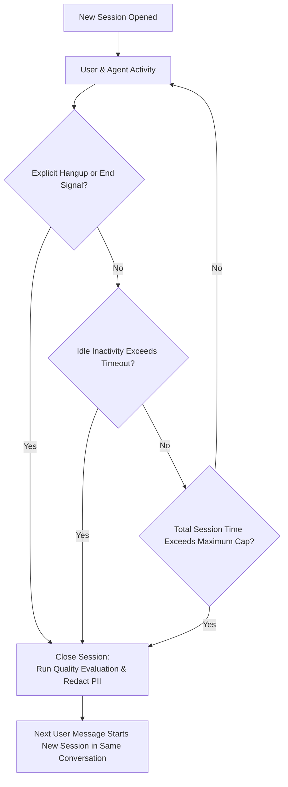

import { Callout } from 'fumadocs-ui/components/callout';

# Conversation Boundaries & Session Lifecycles

Parlot uses a **two-level model of conversations and sessions**. Boundary rules decide when a
**session** moves from **open** to **closed**. Closing a session starts quality evaluations,
personally identifiable information (PII) redaction, analytics rollups, and billing calculations.

## Conversations vs sessions

- **Conversation** — The ongoing thread between a user and an agent on a channel. A conversation
  stays open over time and accumulates sessions.
- **Session** — A bounded interaction episode with a clear start and end. The session is the
  primary unit of evaluation, analytics, and observability. Telemetry—including audio, language
  model responses, tool executions, transcripts, and latency—is grouped under a session.

```
Conversation (ongoing, channel-scoped thread)
  ├── Voice Channel: 1 conversation ↔ 1 session (typical phone call)
  │     └── Session: Call starts 09:00 → Caller hangs up 09:12 (Closed)
  │
  └── Messaging Channels: 1 conversation ⊃ Multiple sessions over time
        ├── Session 1 (Morning): User asks about billing → 15-minute idle timeout → Session closed & evaluated
        └── Session 2 (Afternoon): Same user follows up on payment → New session opened in same conversation
```

### Voice vs messaging

- **Voice** — A single session usually makes up the entire conversation. The call connects, the
  interaction takes place, and the call ends on hangup.
- **Messaging** (SMS, webchat, WhatsApp) — One conversation can span multiple sessions. When a
  customer stops responding, Parlot closes that session so it can be analyzed. A later message
  opens a fresh session in the same conversation.

## Session close triggers

Parlot marks an open session closed when any of these conditions are met:

1. **Explicit end signal** — The agent or telephony gateway signals that the call or interaction
   has concluded (for example, the caller hangs up or the user closes the chat widget).
2. **Idle inactivity timeout** — No new user messages, audio packets, or agent responses for the
   configured duration since the last observed activity.
3. **Maximum session duration cap** — The session has been open longer than the allowed ceiling
   since it started, even if activity continues.



Boundary rules close idle sessions so evaluations, PII redaction, and cost rollups can run. A
maximum duration cap closes hung voice calls. Balanced idle timeouts keep long pauses on
messaging from splitting one inquiry into too many sessions.

## Built-in defaults by channel

| Channel | Idle inactivity timeout | Maximum duration cap | Rationale |
| :--- | :--- | :--- | :--- |
| **Voice** | **Disabled** (0 minutes) | **30 minutes** | Voice calls close on hangup. The 30-minute cap is a safeguard against hung lines. |
| **Webchat** | **15 minutes** | **12 hours** | After 15 minutes of inactivity, the session concludes so evaluations can run. |
| **Text messaging** | **60 minutes** (1 hour) | **12 hours** | SMS is semi-asynchronous; users often take minutes or hours between turns. |
| **WhatsApp** | **24 hours** (1 day) | **7 days** | Aligns with WhatsApp’s standard 24-hour customer service messaging window. |
| **Fallback (custom channels)** | Matches **Voice** (Disabled) | Matches **Voice** (**30 minutes**) | Unrecognized channels adopt voice defaults until you customize them. |

<Callout type="info" title="Automatic fallback">
  Built-in defaults apply as soon as you go live. Custom rules you save take precedence
  immediately.
</Callout>

## Configuring boundaries

### 1. Open Conversation boundaries

In the left sidebar, open **Settings**, then **Conversation boundaries** under **Agents** (or go
to `/settings/conversations`).

### 2. Review channel settings

The table lists supported channels (`voice`, `webchat`, `sms`, and `whatsapp`):

- **Channel** — Canonical channel name
- **Idle timeout** — Inactivity threshold before an idle session closes (for example `15m`,
  `1h`, or `Disabled`)
- **Max duration** — Absolute time ceiling (for example `30m`, `12h`, or `7d`)
- **Status** — `Default` or `Custom`

### 3. Edit a channel

Click the **Edit** (pencil) icon next to any channel:

1. **Idle timeout** — Toggle **Idle timeout**, choose **Minutes**, **Hours**, or **Days**, and
   enter the duration.
2. **Maximum duration** — Choose the unit and enter the ceiling.
3. Click **Save changes**. Updated rules apply to ongoing and future sessions.

### 4. Reset to defaults

- **Revert one channel** — Click **Revert to default** next to a customized channel.
- **Reset all** — Click **Reset to defaults** in the page header to restore the original matrix
  for the organization.

## How session cleanup works

Parlot runs a background sweeper that:

1. Scans open sessions across channels
2. Evaluates last activity against that channel’s idle timeout and maximum duration
3. Marks timed-out sessions closed and dispatches post-processing
4. Runs PII redaction, quality evaluation, and metrics aggregation for closed sessions

## Recommendations

- **Tune webchat to your app flow** — If the chat widget preserves history across page
  navigations, an idle timeout between 15 and 30 minutes keeps inquiries in coherent episodes.
- **Match messaging windows** — On WhatsApp, a 24-hour idle timeout keeps follow-ups in the same
  session.
- **Always set a maximum duration** — A ceiling (such as 12 or 24 hours) closes hung connections
  when an explicit hangup signal is missing.
