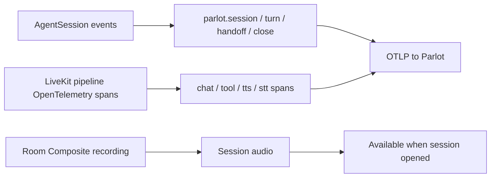

# LiveKit

You already ship voice AI agents on [LiveKit Agents](https://docs.livekit.io/agents/). Parlot’s
MIT `parlotize()` adds session debugging beside your agent: turns, handoffs, latency, and audio
evidence for each call.

Install and env setup: [Quick Start](/sdk/get-started/quick-start). Shared product model:
[Concepts](/sdk/get-started/concepts).

## What you get in Parlot

- **Session + transcript** — who said what, turn timeline, close reason
- **Multi-agent handoffs / agent chain** — routing across agents in one call
- **Pipeline waterfall** (Timeline stage chart) — large language model (LLM), text-to-speech
  (TTS), tools, and speech-to-text (STT) timing when LiveKit pipeline spans are present
- **Usage** — tokens, tool counts
- **Session audio** — LiveKit Room Composite recording → replay when you open the session
- **Export per session** — download transcript + recording (and optionally traces / logs /
  metadata) from the session UI for compliance, reviews, or offline analysis
- **Same debugger if you nest LangGraph** — see the [LangGraph guide](/sdk/guides/langgraph)

## How instrumentation works



**Two layers feed Parlot:**

1. **Events (semantic)** — AgentSession events commit the conversation. When the agent
   transitions `initializing → listening` (`agent_state_changed`), Parlot creates one
   `parlot.session`. Committed messages become `parlot.turn` / handoffs; `close` ends with a
   normalized close reason. This is the episode record (transcript, usage, handoffs), with or
   without pipeline spans.
2. **OpenTelemetry spans (pipeline)** — LiveKit’s internal spans (`llm_*`, `tts_*`,
   `function_tool`, `realtime_inference`, …) are enriched, renamed to the shared GenAI / voice
   vocabulary, and stripped of `lk.*` keys before OpenTelemetry Protocol (OTLP) export. Native
   turn spans contribute latency onto `parlot.turn`, then are dropped from export. Pipeline
   spans unlock the Timeline waterfall and turn latency histograms.

With [LiveKit Agents 1.8+](https://docs.livekit.io/testing/observability/tracing/), LiveKit
stamps OpenTelemetry GenAI attributes on those spans (`gen_ai.input.messages`,
`gen_ai.output.messages`, `gen_ai.system_instructions`, canonical
`gen_ai.provider.name` values such as `openai` / `aws.bedrock` / `gcp.gen_ai`). Parlot prefers
those attributes when present, maps utterance text onto the conversation contract
(`turn.user_text` / `turn.agent_text`), and keeps Agents 1.7 `lk.pii.*` (and legacy `lk.*`)
readers as a fallback. Cached prompt tokens use `gen_ai.usage.cache_read.input_tokens` (or
`gen_ai.usage.input_cached_tokens`); that count is a subset of `gen_ai.usage.input_tokens` —
do not add the two. Realtime model turns export as `chat {model}` with
`gen_ai.operation.name=generate_content`.

**Recording** is a separate path: after the session starts, the agent requests an upload grant
and starts Room Composite egress (audio-only Ogg Vorbis). Session telemetry is sent on its own;
opening the session in Parlot confirms the audio object and sets `audio_available`.

Shared span layers, identity, errors, and capture policies: [Concepts](/sdk/get-started/concepts).
Examples under `examples/livekit/` target `livekit-agents>=1.8`; the instrumentation package
requires `livekit-agents>=1.7`.

## Add it to an existing agent

Two required steps for full behavior:

1. Call `parlotize("…")` **before** constructing `AgentSession`.
2. Call `await ctx.connect()` **before** `session.start()`.

```python
from parlot.instrumentation.livekit import parlotize

parlotize("my-agent", version="0.1.0")

from livekit.agents import AgentSession, JobContext


async def entrypoint(ctx: JobContext):
    await ctx.connect()

    session = AgentSession(...)
    await session.start(agent=..., room=ctx.room)
```

`parlotize()` registers an OTLP `TracerProvider` with `livekit.agents.telemetry`, installs
AgentSession event hooks, and (when recording is enabled) starts Room Composite recording after
the session starts. Pass a stable deployment id; use `version=` for a real deployment label
(otherwise Parlot stamps `"unknown"`).

If you need the first agent greeting on the session recording, pass **`await_recording=True`**
(with `await ctx.connect()` before `session.start()`). That waits for recording to start before
connect returns and may add a little latency; leave it off for the lowest time-to-first-speech.

```python
parlotize("my-agent", version="0.1.0", await_recording=True)
```

Environment: `PARLOT_ENDPOINT`, `PARLOT_API_KEY` — see [Environment Variables](/sdk/env-vars).
Recording, session logs, and generative AI content capture are on by default for new tenants;
configure in Settings or via `parlotize(...)` kwargs — see
[Concepts → Recording vs telemetry](/sdk/get-started/concepts#recording-vs-telemetry). LiveKit
recording also needs agent `LIVEKIT_*` credentials with **`roomRecord`**.

`parlotize()` options: [Interactive API Reference](/docs/ref/python/parlot/instrumentation/livekit.html)
(LiveKit-only kwargs include `record`, `await_recording`, `auto_escalate_sip`, …). Package
overview: [Python SDK Reference](/sdk/python).

## Named worker dispatch (`agent_name`)

LiveKit’s **`agent_name`** (which jobs are eligible for which rooms) is separate from Parlot’s
`parlotize("…")` / `session.agent_id` (canonical product identity on telemetry).

Prefer an explicit name on the RTC session entrypoint:

```python
from livekit.agents import AgentServer, JobContext

server = AgentServer()


@server.rtc_session(agent_name="healthcare")
async def entrypoint(ctx: JobContext):
    await ctx.connect()
    ...
```

Give the worker an explicit name so only matching rooms get this agent. Paths such as LiveKit
`WarmTransferTask` open a second room for briefing; an unnamed worker can be auto-dispatched
there and create a **second Parlot session** for the same caller journey. Keep playground,
Session Initiation Protocol (SIP) dispatch rules, and `lk dispatch` aligned with the same name.
See the [healthcare example](https://github.com/parlot-ai/sdk/blob/main/examples/livekit/healthcare/README.md)
for a full WarmTransferTask setup.

## Human escalation

Semantics and role vocabulary live in
[Concepts → Human escalation](/sdk/get-started/concepts#human-escalation). Import helpers from
the LiveKit package:

```python
from parlot.instrumentation.livekit import record_human_rep, human_escalation

record_human_rep("support_rep_jane", label="Jane")

# Or wrap a dial / transfer:
# with human_escalation(label="L2 Support Queue"):
#     await session.dial(sip_uri)
```

For SIP warm transfer auto-detect, set `parlotize("my-agent", auto_escalate_sip=True)` and a
named `agent_name` so the briefing room stays on one Parlot session. Or match participant
metadata with `escalation_metadata_match={...}`.

## Next

- [Quick Start](/sdk/get-started/quick-start)
- [Concepts](/sdk/get-started/concepts)
- Examples: [`examples/livekit/`](https://github.com/parlot-ai/sdk/tree/main/examples/livekit/)
- [Python SDK Reference](/sdk/python) · [Interactive API Reference](/docs/ref/python/parlot/instrumentation/livekit.html)
- Nesting LangGraph inside a voice agent? [LangGraph guide](/sdk/guides/langgraph)
