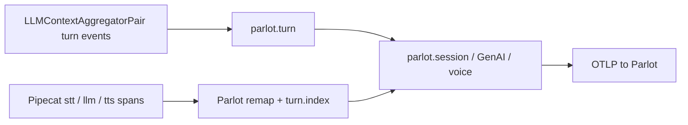

# Pipecat

You already ship [Pipecat](https://docs.pipecat.ai/) voice AI agents. Parlot’s MIT `parlotize()`
adds a production session debugger: turns, STT/LLM/TTS waterfall, and usage — on the shared
Conversation Contract every Parlot adapter emits.

Install and env setup: [Quick Start](/sdk/get-started/quick-start). Shared product model:
[Concepts](/sdk/get-started/concepts).

## What you get in Parlot

- **Session + transcript** — turns, close reason, `framework=pipecat`
- **Pipeline waterfall** — STT / LLM / TTS timing from Pipecat’s OpenTelemetry spans
- **Usage** — tokens and character counts when `enable_metrics` / `enable_usage_metrics` are on
- **Session audio** — optional stereo capture via `ParlotRecordingProcessor` (WAV segments by default)
- **Search by conversation id** — Pipecat `conversation_id` → `platform.ref.conversation_id`

## How instrumentation works



1. Call `parlotize("…")` once at process start. This installs a TracerProvider that exports to
   Parlot, patches `PipelineWorker` so tracing + metrics default on, and auto-wires turn
   handlers onto `LLMUserAggregator` / `LLMAssistantAggregator`.
2. Build your pipeline with **`LLMContextAggregatorPair`**. Place the **user** aggregator
   early (after STT / before the LLM) and the **assistant** aggregator **after**
   `transport.output()` so committed transcripts include what was spoken.
3. Pass `enable_tracing=True` and `enable_turn_tracking=True` on `PipelineWorker`
   (or rely on the patch).
4. Do **not** call Pipecat’s `setup_tracing()` afterward — it would replace the global
   TracerProvider and drop Parlot processors. `parlotize` is the Parlot equivalent.

Committed user/assistant transcripts from aggregator events
(`on_user_turn_stopped` / `on_assistant_turn_stopped`, plus realtime
`on_user_turn_message_added`) mint `parlot.turn`. `on_*_turn_started` reserves
turn indices early for waterfall nesting. PipelineWorker’s
`UserBotLatencyObserver` feeds `turn.e2e_latency_s` on the next agent turn.
Pipecat’s nested conversation→turn OTEL tree is still used for session open/close
and STT/LLM/TTS nesting under `turn.index` — those spans do not mint contract turns.

## Add it to an existing bot

```python
from pipecat.processors.aggregators.llm_context import LLMContext
from pipecat.processors.aggregators.llm_response_universal import (
    LLMContextAggregatorPair,
)
from parlot.instrumentation.pipecat import ParlotRecordingProcessor, parlotize

parlotize("my-pipecat-agent", version="0.1.0", record=True)

context = LLMContext(messages)
context_aggregator = LLMContextAggregatorPair(context)

pipeline = Pipeline([
    transport.input(),
    stt,
    context_aggregator.user(),
    llm,
    tts,
    transport.output(),
    ParlotRecordingProcessor(),  # after output — mixed dual-mono stereo WAV segments
    context_aggregator.assistant(),  # after output — required for agent parlot.turn
])

worker = PipelineWorker(
    pipeline,
    params=PipelineParams(enable_metrics=True, enable_usage_metrics=True),
    enable_tracing=True,
    enable_turn_tracking=True,
    conversation_id="optional-stable-id",
)
```

```bash
export PARLOT_ENDPOINT=https://ingest.parlot.ai
export PARLOT_API_KEY=<org-scoped-key>
```

Call `parlotize` once from `parlot.instrumentation.pipecat` for the process that owns the
pipeline. Do not mix in another framework’s `parlotize` in the same agent process.

### Recording

With `record=True` (or Settings → Recording allowlists) and `ParlotRecordingProcessor` in the
pipeline, the agent uploads ~30s stereo WAV segments via a presigned PUT, then
stitches them together. Parlot stitches gaps as silence, normalizes for playback, and
applies close-gated PII beeps when redaction is on.

- Default deps stay thin (`wave` + `httpx`); stereo PCM WAV at 16 kHz is ~0.5 Mbps/call upstream.
  Optional `parlot[recording-opus]` / package extra `recording-opus` encodes Opus/OGG segments
  instead when you need a smaller upload bitrate.
- Place the processor **after** `transport.output()` so both directions are buffered.
- Fail-open: upload/complete errors stamp `session.recording.status=failed` and never break the call.
- Playback is always the session’s current signed URL (redacted when policy requires) — not the
  raw audio URI.

## Example

[`examples/pipecat/minimal-voice/`](https://github.com/parlot-ai/sdk/tree/main/examples/pipecat/minimal-voice) —
adapted from Pipecat’s [open-telemetry/langfuse](https://github.com/pipecat-ai/pipecat-examples/tree/main/open-telemetry/langfuse) demo.

## Related

- [Concepts](/sdk/get-started/concepts) — Conversation Contract and shared capture policies
- [Pipecat OpenTelemetry docs](https://docs.pipecat.ai/api-reference/server/utilities/opentelemetry)
