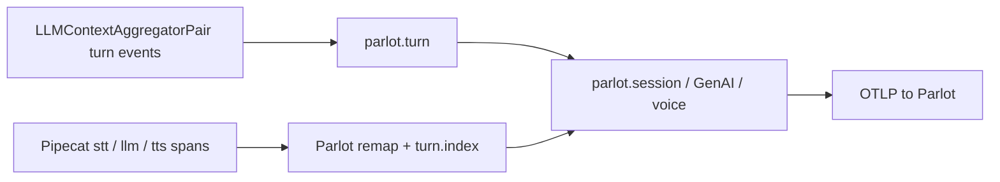

# Pipecat

You already ship [Pipecat](https://docs.pipecat.ai/) voice AI agents. Parlot’s MIT `parlotize()`
adds a production session debugger: turns, STT/LLM/TTS waterfall, and usage — on the shared
Conversation Contract every Parlot adapter emits.

Install and env setup: [Quick Start](/sdk/get-started/quick-start). Shared product model:
[Concepts](/sdk/get-started/concepts).

## What you get in Parlot

- **Session + transcript** — turns, close reason, `framework=pipecat`
- **Pipeline waterfall** — STT / LLM / TTS timing from Pipecat’s OpenTelemetry spans
- **Usage** — tokens and character counts when `enable_metrics` / `enable_usage_metrics` are on
- **Session audio** — optional stereo capture via `ParlotRecordingProcessor` (WAV segments by default)
- **Search by conversation id** — Pipecat `conversation_id` → `platform.ref.conversation_id`

## How instrumentation works



1. Call `parlotize("…")` once at process start. This installs a TracerProvider that exports to
   Parlot, patches `PipelineWorker` so tracing + metrics default on, and auto-wires turn
   handlers onto `LLMUserAggregator` / `LLMAssistantAggregator`.
2. Build your pipeline with **`LLMContextAggregatorPair`**. Place the **user** aggregator
   early (after STT / before the LLM) and the **assistant** aggregator **after**
   `transport.output()` so committed transcripts include what was spoken.
3. Pass `enable_tracing=True` and `enable_turn_tracking=True` on `PipelineWorker`
   (or rely on the patch).
4. `parlotize()` installs the tracer provider, so skip Pipecat’s `setup_tracing()` afterward —
   a second setup would replace the global TracerProvider and drop Parlot processors.

Committed user/assistant transcripts from aggregator events
(`on_user_turn_stopped` / `on_assistant_turn_stopped`, plus realtime
`on_user_turn_message_added`) mint `parlot.turn`. Early `on_*_turn_started` events reserve
turn indices for waterfall nesting; empty or aborted stops release those reservations so
session `turn_count` / `turn_index_max` at close match minted contract turns only.
PipelineWorker’s `UserBotLatencyObserver` feeds `turn.e2e_latency_s` on the next agent turn.
Pipecat’s nested conversation→turn OTEL tree still drives session open/close and
STT/LLM/TTS nesting under `turn.index`.

## Requirements

Create `LLMUserAggregator` and `LLMAssistantAggregator` in your pipeline (typically via
`LLMContextAggregatorPair`) so the Parlot timeline shows user/agent turns and transcript.

- Place the **user** aggregator early (after STT / before the LLM).
- Place the **assistant** aggregator **after** `transport.output()` so committed
  text matches what was spoken.
- Call `parlotize()` **before** constructing those aggregators so handlers
  auto-wire. If they already exist, call `attach_aggregators(user, assistant)`.
- Add both aggregators to get `parlot.turn`; session and STT/LLM/TTS spans export either way.

Your own event handlers and `PipelineWorker(observers=[...])` keep working —
Parlot **appends** handlers and observers alongside yours.

## Add it to an existing bot

Highlighted lines are what you add:

```python
from pipecat.audio.vad.silero import SileroVADAnalyzer
from pipecat.pipeline.pipeline import Pipeline
from pipecat.pipeline.worker import PipelineParams, PipelineWorker
from pipecat.processors.aggregators.llm_context import LLMContext
from pipecat.processors.aggregators.llm_response_universal import (
    LLMContextAggregatorPair,
    LLMUserAggregatorParams,
)
from parlot.instrumentation.pipecat import (  # [!code ++]
    ParlotRecordingProcessor,  # [!code ++]
    attach_aggregators,
    parlotize,  # [!code ++]
)  # [!code ++]

parlotize("my-pipecat-agent", version="0.1.0", record=True)  # [!code ++]

context = LLMContext(messages)
user_aggregator, assistant_aggregator = LLMContextAggregatorPair(
    context,
    user_params=LLMUserAggregatorParams(
        vad_analyzer=SileroVADAnalyzer(),
    ),
)
# Only needed if aggregators were built before parlotize():
# attach_aggregators(user_aggregator, assistant_aggregator)

pipeline = Pipeline([
    transport.input(),
    stt,
    user_aggregator,
    llm,
    tts,
    transport.output(),
    ParlotRecordingProcessor(),  # [!code ++]
    assistant_aggregator,
])

worker = PipelineWorker(
    pipeline,
    params=PipelineParams(enable_metrics=True, enable_usage_metrics=True),
    enable_tracing=True,  # [!code ++]
    enable_turn_tracking=True,  # [!code ++]
    conversation_id="optional-stable-id",
    # Your observers stay; Parlot appends alongside this list.
    # observers=[MyCustomObserver()],
)
```

```bash
export PARLOT_ENDPOINT=https://ingest.parlot.ai
export PARLOT_API_KEY=<org-scoped-key>
```

Call `parlotize` once from `parlot.instrumentation.pipecat` for the process that owns the
pipeline. Do not mix in another framework’s `parlotize` in the same agent process.

### Recording

With `record=True` (or Settings → Recording allowlists) and `ParlotRecordingProcessor` in the
pipeline, the agent uploads ~30s stereo WAV segments via a presigned PUT, then
stitches them together. Parlot stitches gaps as silence, normalizes for playback, and
applies close-gated PII beeps when redaction is on.

- Default deps stay thin (`wave` + `httpx`); stereo PCM WAV at 16 kHz is ~0.5 Mbps/call upstream.
  Optional `parlot[recording-opus]` / package extra `recording-opus` encodes Opus/OGG segments
  instead when you need a smaller upload bitrate.
- Place the processor **after** `transport.output()` so both directions are buffered.
- Fail-open: upload/complete errors stamp `session.recording.status=failed` and never break the call.
- Playback always uses the session’s current signed URL (redacted when policy requires).

## Example

[`examples/pipecat/minimal-voice/`](https://github.com/parlot-ai/sdk/tree/main/examples/pipecat/minimal-voice) —
adapted from Pipecat’s [open-telemetry/langfuse](https://github.com/pipecat-ai/pipecat-examples/tree/main/open-telemetry/langfuse) demo.

## Related

- [Concepts](/sdk/get-started/concepts) — Conversation Contract and shared capture policies
- [Pipecat OpenTelemetry docs](https://docs.pipecat.ai/api-reference/server/utilities/opentelemetry)
